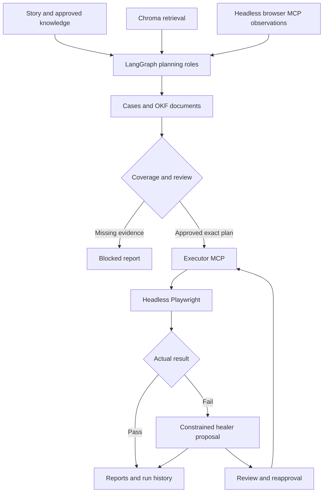

# Architecture and execution contract

LangGraph coordinates stateful roles. LangChain supplies chat-model adapters, schema-constrained outputs, embeddings, messages and chunk splitting. MCP standardizes tool calls between the orchestrator and local browser/execution services. Playwright is the browser execution engine. Chroma is the vector index. Google OKF is a portable documentation shape. DeepEval evaluates selected AI outputs. reportingLabs and Playwright render test evidence. These responsibilities are different and can be changed independently.

## Boundaries

| Module | Contract |
|---|---|
| `models.ts` | Strict Zod story/plan/step schema and criteria references; no generated shell/eval actions |
| `knowledge.ts` | Explicit embeddings and original text, current source-version replacement, scoped approved retrieval |
| `auth.ts` | RS256 JWT, UI Bridge, authenticated-marker verification, ignored storageState |
| `browser-server.ts` | stdio MCP with bounded navigation/snapshot/semantic clicks, fixed headless launcher |
| `workflow.ts` | Ordered LangGraph roles, stage events and diagnostic state snapshots |
| `documents.ts` | Source documents, criteria CSV, exact-plan digest, generated TypeScript wrappers and report index |
| `runner.ts` | Fixed action semantics and Playwright web-first assertions |
| `tool-server.ts` | Framework MCP tools for plan/retrieval/run/status |
| `execution.ts` | Validate contract, auth/review gate, fixed Playwright CLI invocation, real exit code and status persistence |
| `evaluation.ts` | Optional actual DeepEval metrics; a missing judge produces no fabricated score |
| `files.ts` | Paths, content hashes, local run history, incidents and reviewed-memory loading |

Generated tests execute a validated data plan through a fixed TypeScript runner. The model does not emit arbitrary executable source. This makes browser behavior reviewable and prevents a healer from quietly introducing sleeps, skipped tests, shell commands or different expected values. Supporting a new interaction requires a reviewed change to both the schema and runner.

The custom browser MCP server deliberately uses the same pinned `@playwright/test` installation. It is not the separately versioned `@playwright/mcp` server. That server can be integrated later if its capabilities are needed, after checking version compatibility, authentication, headless settings and available tool permissions. The custom server currently exposes only navigation, accessibility snapshots and semantic clicks; it does not offer arbitrary page evaluation or shell execution.

## Review and healing

Structural coverage means every criterion ID is mapped to at least one case with an assertion and no unresolved missing information. That is useful traceability, not proof of requirement adequacy. A case could be incorrectly mapped. Human review and optional DeepEval adequacy checks help detect this; only executing meaningful assertions tests the application.

Live plans require exact story/plan review. The approval file hashes both files. Editing either invalidates approval. Exporting a reviewed bundle preserves that digest for CI. The healer can propose only action-target locator changes, and an application command validates that constraint again before replacing the plan. It cannot change assertion locators/values, inputs, steps, criterion mappings, preconditions or navigation. If the real application behavior changed, review it as a requirement/product issue rather than healing it into a false pass.

The graph's `checkpoint.json` and event log are diagnostics. A proper durable LangGraph checkpointer/resume protocol, idempotent side-effect recovery and distributed task queue are future work. Do not resume a partially completed payment/order flow by blindly retrying the entire graph.

## Framework memory

The runtime reads curated Markdown lessons for planning/healing and writes unverified incident/run JSONL records automatically. Coding agents also receive `AGENTS.md` instructions to read the same lessons. A verified lesson includes cause/prevention, evidence and a regression reference. This allows future agents to retrieve prior fixes without making automatically generated incident text an approved requirement or changing model weights.

## Evaluation layers

| Layer | What it establishes | What it cannot establish |
|---|---|---|
| TypeScript/Zod | Well-formed executable plan data and compatible code | Correct business expectations |
| Unit checks | Signing, gates, retrieval filtering and repair invariants | Real org access or UI behavior |
| Chroma integration | Actual vector/text persistence, restart, update/delete and query filtering | Semantic model retrieval quality |
| DeepEval deterministic metric smoke | Native TS SDK metric runs with real score output | LLM judged faithfulness/quality |
| DeepEval live metrics | Judge opinion on supplied plan/context/criteria | Browser success or infallible business validation |
| Playwright execution | Actual configured browser assertions passed/failed | Complete coverage of every unstated requirement |

DeepEval live thresholds: faithfulness ≥0.85; answer relevancy ≥0.80; requirement-assertion adequacy GEval ≥0.80. Faithfulness/relevancy receive the plan summary and case titles with the story/retrieved passages; GEval receives the full structured plan and acceptance criteria. This is not a complete assertion-by-assertion faithfulness benchmark. Judge model choice and nondeterminism affect scores; retain inputs and judge reasons. Evaluation failure blocks the suite, but a `not_run` evaluation is allowed when the caller did not request it.

## n8n, ADK and other tools

n8n is an optional external workflow/trigger layer: story webhook → CLI/CI run → notification. LangGraph handles application-level agent state and decisions inside this framework. They can cooperate, but adding n8n is not required to run it. No n8n server/workflow is bundled. Do not expose the local MCP server publicly as an unauthenticated webhook.

Google **ADK** is an alternative agent development/orchestration toolkit. Google **OKF** is the knowledge document format implemented here. They are different products. A second orchestrator is unnecessary for this starter. Google Colab is a hosted notebook environment; use a proper Node/Codex/CI environment for this repository's browser sessions and persistent services.

Optional later work: Jira/ADO issue ingestion, test-management synchronization, persona-aware RAG, Salesforce metadata ingestion, record seeding/cleanup through supported APIs, SOQL postconditions, accessibility checks, visual comparisons, reranking, semantic evaluation datasets and test-impact selection. Those integrations are not present merely because a role name exists.
